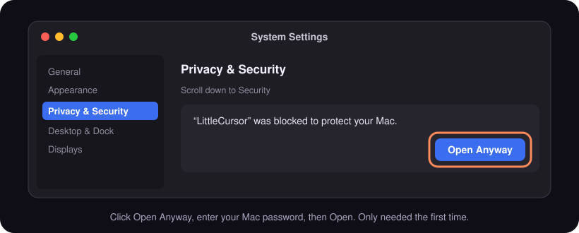
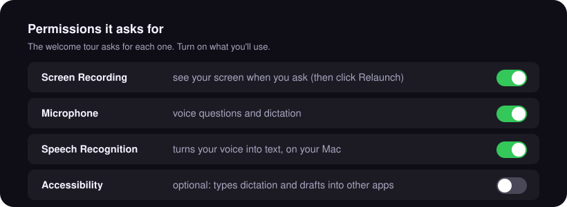
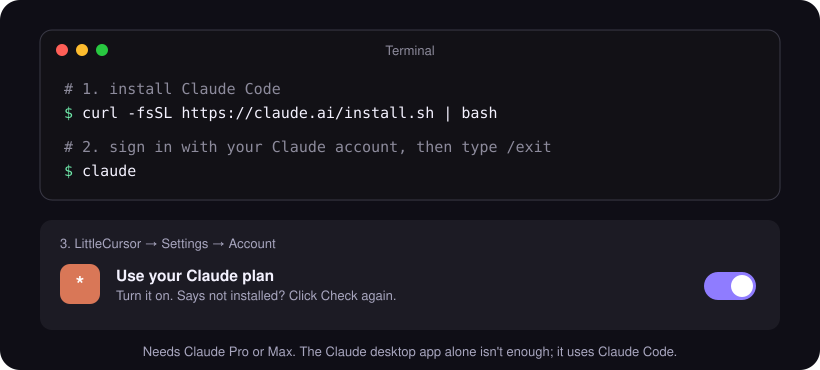

# Install LittleCursor

**Needs:** macOS 14 or newer, Apple Silicon or Intel. Free, no account.

## 1. Download
**[⬇ Download the latest LittleCursor](https://github.com/TenFinges/littlecursor/releases/latest)** → under **Assets**, click `LittleCursor-x.y.z.zip`.

## 2. Move it to Applications
Double-click the zip, then drag **LittleCursor.app** into **Applications**.


## 3. Open it (first time only)
Open LittleCursor from Applications. macOS blocks it the first time because the beta isn't signed by Apple yet:
1. Click **Done** on the warning.
2. Open **System Settings → Privacy & Security**, scroll down, click **Open Anyway**.
3. Enter your Mac password, then click **Open**.



> Prefer Terminal? `xattr -dr com.apple.quarantine /Applications/LittleCursor.app`, then open it normally.

## 4. Allow permissions
The welcome tour asks for each one. For **Screen Recording** and **Accessibility**, System Settings opens: flip the switch next to LittleCursor and the tour comes back by itself. If macOS asks to **Quit & Reopen**, do it: the tour picks up where you were.



LittleCursor only looks at your screen and listens while you're asking something.

## 5. Use it


- **Esc** stops an answer (sent something by mistake?). Press again to clear the drawings, again to close. Closed it by mistake? Click **Undo** on the message that appears.
- Change any shortcut in **Settings → Shortcuts**.

LittleCursor lives in the **Dock** and the **menu bar**. Click the Dock icon for Settings.

---

## Use your Claude plan (optional)
Have **Claude Pro or Max**? Answers can come from Claude instead of the free AI. The app walks you through it: **Have Claude Pro or Max? Use it** in the welcome tour, or **Settings → Account → Set up**. By hand:



1. Open **Terminal** and run:
   ```
   curl -fsSL https://claude.ai/install.sh | bash
   ```
2. Run `claude`, sign in with your Claude account, then type `/exit`.
3. In LittleCursor: **Settings → Account → Use your Claude plan** → turn it on. It notices Claude Code by itself within a few seconds.

The Claude desktop app alone isn't enough: this uses Claude Code. Screenshots go from your Mac to Anthropic, never through LittleCursor's server.

## Your own Gemini key (optional)
Get a free key at [aistudio.google.com/apikey](https://aistudio.google.com/apikey), then paste it in **Settings → Account**. No monthly limit.

---

## Updates
Automatic. New versions download in the background and install the next time LittleCursor quits. To update now: menu bar icon → **Restart to Update**.

On 0.3.x? Download the latest once and replace the app (quit it first). Updates are automatic after that.

## Quit
**⌘Q twice**, the Dock icon (right-click → **Quit**), or **Quit** at the bottom of Settings.

## Uninstall
**Settings → About → Uninstall LittleCursor…** removes the app and everything it stored.

## Problems
**Settings → About → Report a bug**, or [open an issue](https://github.com/TenFinges/littlecursor/issues/new). Issues are public, so read before posting.
