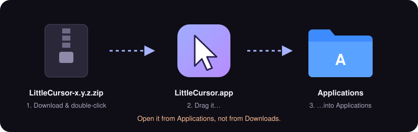
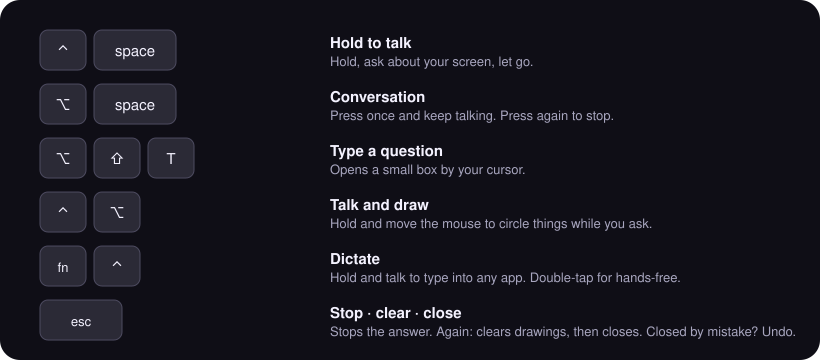

# LittleCursor

An AI that lives by your cursor on your Mac. Hold **⌃ Space**, ask about anything on your screen, and it answers right there, drawing on your screen as it explains.

**[⬇ Download](https://github.com/TenFinges/littlecursor/releases/latest)** · macOS 14+ · Apple Silicon and Intel · free beta, no account

## Install in 3 steps

1. [Download](https://github.com/TenFinges/littlecursor/releases/latest) the zip and double-click it.
2. Drag **LittleCursor.app** into **Applications** and open it.
3. First time only: **System Settings → Privacy & Security → Open Anyway**.

Full guide with pictures: **[INSTALL.md](INSTALL.md)**

## Shortcuts

## Which AI it uses
- **Free AI** (default): works right away, 150 questions a month.
- **Your Claude plan** (Pro/Max): [set up in 3 steps](INSTALL.md#use-your-claude-plan-optional).
- **Your own Gemini key**: [no limit](INSTALL.md#your-own-gemini-key-optional).

## Privacy
It only sees your screen while you're asking. Your screen, voice and questions are never stored on our server. [PRIVACY.md](PRIVACY.md)

## Help
[Open an issue](https://github.com/TenFinges/littlecursor/issues/new), or **Settings → About → Report a bug**.

This repository holds releases only; the source isn't public.
